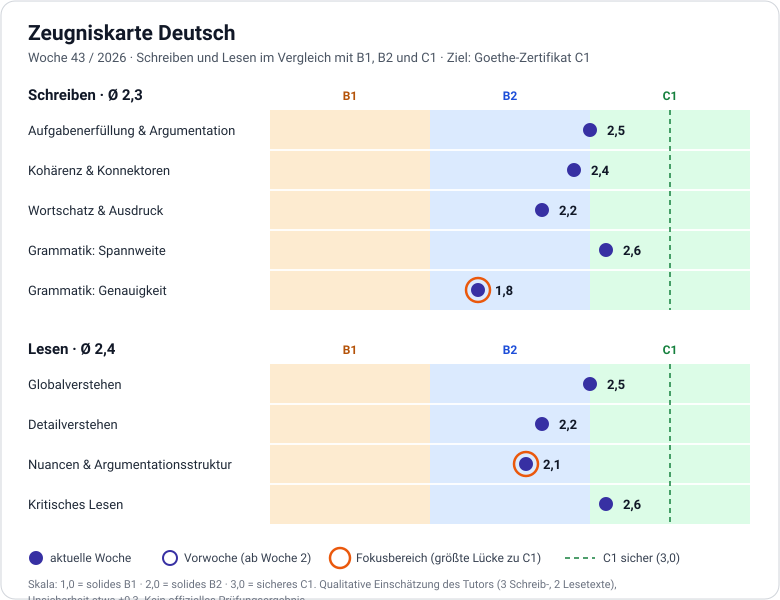

# Zeugniskarte Deutsch: Schreiben und Lesen

> Wöchentlich aktualisiert. Zuletzt: 2026-10-20 · Ziel: Goethe-Zertifikat C1 (2027)
> Hören und Sprechen sind noch nicht bewertet. Sie kommen dazu, sobald wir eine verlässliche Methode haben.

## Aktuelle Woche: 2026-W43 (erste Karte, gilt als Ausgangswert)

| Teil | Dimension | Note | Lücke zu C1 | Belege |
|---|---|---|---|---|
| Schreiben | Aufgabenerfüllung & Argumentation | 2,5 | 0,5 | Position, Begründung, Beispiel und Gegenargument vorhanden. Die Antwort auf das Gegenargument blieb dünn. |
| Schreiben | Kohärenz & Konnektoren | 2,4 | 0,6 | einerseits/andererseits, zwar…aber und nämlich korrekt. Übergänge teils noch holprig (sondern/stattdessen). |
| Schreiben | Wortschatz & Ausdruck | 2,2 | 0,8 | Gute Spannweite (reizen, meistern, Irrglaube), aber Kollokationen mit Einfluss des Englischen und eigene Wortbildungen (Zeitaufwändigkeit, Weltvernetzung). |
| Schreiben | Grammatik: Spannweite | 2,6 | 0,4 | Relativsätze, Infinitivsätze, Passiversatz (sich … lassen), Inversion nach Nebensatz. Nominalstil und Partizipialattribute noch ungeprüft. |
| Schreiben | Grammatik: Genauigkeit | 1,8 | 1,2 | Artikel/Genus (11 Fälle), Verbstellung im dass-Satz (7), Konjunktiv II im wenn-Satz (2). Sinkt bei langen, abstrakten Sätzen. |
| Lesen | Globalverstehen | 2,5 | 0,5 | Thema und Kernaussage beider Texte erfasst. Die These des zweiten Textes wurde leicht überzogen. |
| Lesen | Detailverstehen | 2,2 | 0,8 | Begriffe wie Kulanz sicher. In Text 1 fehlten Begründung und Pointe, in Text 2 die tatsächliche Antwort auf das Gegenargument. |
| Lesen | Nuancen & Argumentationsstruktur | 2,1 | 0,9 | Erkennt Argument und Gegenargument, benennt aber Wendepunkte und die Wertung des Textes noch nicht sicher. |
| Lesen | Kritisches Lesen | 2,6 | 0,4 | Hat bemerkt, dass der Text das Schwierigkeits-Gegenargument nicht beantwortet, und fordert konkrete Belege. Wenig Daten. |

**Durchschnitt:** Schreiben 2,3 · Lesen 2,4 (beides oberes B2 mit Ansätzen von C1)

### Fokus-Empfehlung
1. **Schreiben, Grammatik: Genauigkeit (Lücke 1,2).** Das ist die größte Lücke. Hebel: dass-Sätze beim Wiedergeben fremder Gedanken, Genus von Nomen auf -ment und von Fremdwörtern, Konjunktiv II im wenn-Satz. Methode: überarbeiten (Schreiben B), nicht pauken.
2. **Lesen, Nuancen & Argumentationsstruktur (Lücke 0,9).** Bei jedem Text benennen: These, Gegenargument, Antwort des Textes darauf, Wertung des Autors.

### Ziele für die nächste Woche
- Mindestens 1 Schreibaufgabe (A und B) und 1 Lesetext.
- In der Schreibaufgabe sind mindestens 3 von 4 dass-Sätzen bzw. Konjunktiv-II-Sätzen korrekt.
- Im Lesetext wird die Antwort des Textes auf sein Gegenargument korrekt benannt.

## Verlauf
Pro Woche kommt eine neue Spalte dazu. Ein Punkt (·) heißt: Wert aus der Vorwoche übernommen, weil keine neuen Daten vorlagen.

| Dimension | 2026-W43 |
|---|---|
| Aufgabenerfüllung & Argumentation | 2,5 |
| Kohärenz & Konnektoren | 2,4 |
| Wortschatz & Ausdruck | 2,2 |
| Grammatik: Spannweite | 2,6 |
| Grammatik: Genauigkeit | 1,8 |
| **Schreiben Ø** | **2,3** |
| Globalverstehen | 2,5 |
| Detailverstehen | 2,2 |
| Nuancen & Argumentationsstruktur | 2,1 |
| Kritisches Lesen | 2,6 |
| **Lesen Ø** | **2,4** |

## Was die Niveaus bedeuten (Orientierung)
| Dimension | B1 | B2 | C1 |
|---|---|---|---|
| Aufgabenerfüllung & Argumentation | Meinung mit einfachen Gründen | Position mit Beispielen, geht auf Gegenargumente ein | Entwickelt die Argumentation Schritt für Schritt, gewichtet Argumente, widerlegt Gegenargumente überzeugend |
| Kohärenz & Konnektoren | einfache Verknüpfungen (und, weil, aber) | klare Gliederung, abwechslungsreiche Konnektoren | souveräne Textgliederung, fließende Übergänge |
| Wortschatz & Ausdruck | Alltagswortschatz, Umschreibungen | breit, gelegentlich unpassende Kollokationen | präzise, idiomatisch, stilistisch passend |
| Grammatik: Spannweite | einfache Nebensätze | Relativsätze, Passiv, Konjunktiv II | Nominalstil, Partizipialattribute, Konjunktiv I, bewusste Variation |
| Grammatik: Genauigkeit | Fehler stören gelegentlich | wenige Fehler, selten Missverständnisse | durchgehend hohe Genauigkeit, Fehler selten und unauffällig |
| Globalverstehen | Hauptpunkte klarer, einfacher Texte | Hauptaussage komplexer Texte | Hauptaussage auch in langen, abstrakten Texten |
| Detailverstehen | Einzelinformationen in einfachen Texten | Details in komplexen Texten | auch implizite und versteckte Informationen |
| Nuancen & Argumentationsstruktur | grober Textaufbau | Argument und Gegenargument | Haltung, Ironie, Wendepunkte, implizite Bedeutung |
| Kritisches Lesen | selten | erkennt einfache Meinungsäußerungen | prüft Belege, erschließt Unbekanntes aus dem Kontext, erkennt Stilebenen |

## Skala und Methode
- **Skala:** 1,0 = solides B1 · 2,0 = solides B2 · 3,0 = sicheres C1 (prüfungsreif). Zwischenwerte bedeuten zum Beispiel: 2,5 = oberes B2 mit Ansätzen von C1. Die Zonen im Diagramm: unter 1,5 B1, 1,5 bis 2,5 B2, ab 2,5 C1-Bereich. Sicher ist C1 erst bei 3,0.
- **Grundlage:** Die Dimensionen orientieren sich an den üblichen Prüfungskriterien (Aufgabenerfüllung, Kohärenz, Wortschatz, Grammatik), sind aber keine offiziellen Bewertungen.
- **Gewichtung:** Alle Dimensionen zählen gleich. Der Durchschnitt je Teil ist das einfache Mittel.
- **Datenbasis in Woche 43:** 3 Schreibtexte (Ausgangstext, Schreiben A, Schreiben B) und 2 Lesetexte. Das ist wenig.
- **Unsicherheit:** etwa ±0,3. Veränderungen unter 0,3 sind Rauschen. Erst nach 3 bis 4 Wochen ist ein Trend verlässlich.
- **Kalibrierung:** Die Noten sind die Einschätzung einer KI. Sobald wir einen Modelltest für Lesen mit Lösungsschlüssel haben, eichen wir die Lesen-Skala an dessen Ergebnis.

## So wird die Karte aktualisiert
1. Nach der letzten Aufgabe der Woche sagst du „Zeugniskarte“.
2. Ich bewerte nur Dimensionen, zu denen diese Woche Daten vorliegen. Alles andere wird mit · übernommen. In Wochen ohne Aufgaben gibt es keine Karte.
3. Ich liefere eine neue Datei `GER_REPORTCARD_<Jahr>-W<Woche>.svg`, ersetze den Abschnitt „Aktuelle Woche“, ergänze die Spalte im Verlauf und gebe dir die aktualisierte `GER_REPORTCARD.md`.
4. Du committest beides. Alte SVG-Dateien bleiben im Repository und dokumentieren den Verlauf.
