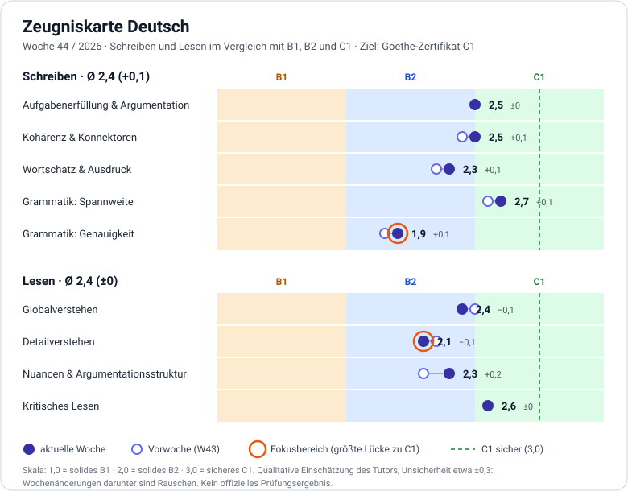

# Zeugniskarte Deutsch: Schreiben und Lesen

> Wöchentlich aktualisiert. Zuletzt: 2026-10-28 · Ziel: Goethe-Zertifikat C1 (2027)
> Hören und Sprechen sind noch nicht bewertet. Sie kommen dazu, sobald wir eine verlässliche Methode haben.

## Aktuelle Woche: 2026-W44

| Teil | Dimension | Note | Δ zur Vorwoche | Lücke zu C1 | Belege (seit 2026-W43) |
|---|---|---|---|---|---|
| Schreiben | Aufgabenerfüllung & Argumentation | 2,5 | ±0 | 0,5 | Absatz mit Rollen (These, Grund, Beispiel, Gegenargument, Antwort, Fazit) vollständig und klar. Die Antwort auf das Gegenargument bleibt eine Verallgemeinerung ohne Beispiel. |
| Schreiben | Kohärenz & Konnektoren | 2,5 | +0,1 | 0,5 | Klare Gliederung, rhetorische Frage, „Zusammenfassend …“ richtig. Nach „Zweitens“ und „Zum Beispiel“ rutscht das Verb noch. |
| Schreiben | Wortschatz & Ausdruck | 2,3 | +0,1 | 0,7 | Redewendungen gut aufgenommen (auf die Palme bringen, aus der Haut fahren). Weiter Kollokationsfehler und falsche Freunde (Apotheke, engagieren, identifizieren). |
| Schreiben | Grammatik: Spannweite | 2,7 | +0,1 | 0,3 | Partizip I frei gebildet („langsam laufende Menschen“), Relativsatz mit Präposition, Infinitivgruppe als Subjekt, Konjunktiv I in der indirekten Frage. In den Satzbau-Einheiten Partizipialattribute und indirekte Rede sicher. |
| Schreiben | Grammatik: Genauigkeit | 1,9 | +0,1 | 1,1 | In freien Entwürfen weiter viele Fehler (Artikel, Reflexivität, Verbstellung). In Sätzen mit nur einem Risiko etwa 1 bis 2 Fehler pro Satz. Die Routine wirkt vor allem beim Teilen langer Sätze. |
| Lesen | Globalverstehen | 2,4 | −0,1 | 0,6 | Thema und Aufbau beider Texte erfasst. Die These blieb im MeinBezirk-Kommentar unvollständig, im t3n-Text war sie überzogen. |
| Lesen | Detailverstehen | 2,1 | −0,1 | 0,9 | Je ein Detailfehler pro Text (Wirtschaftsrat/Wissenschaftsrat; Leserbriefe statt „andere gefragt“). Antworten kamen aus dem Gedächtnis statt aus dem Text. |
| Lesen | Nuancen & Argumentationsstruktur | 2,3 | +0,2 | 0,7 | Beide Wendepunkte („jedoch“) sicher gefunden. Ton aber falsch eingeordnet (polemisch statt selbstironisch), Zugeständnis nur halb erfasst. |
| Lesen | Kritisches Lesen | 2,6 | ±0 | 0,4 | Fragt nach Belegen und Autorenperspektive. Verwechselt aber „subjektiv“ mit „polemisch“. |

**Durchschnitt:** Schreiben 2,4 (+0,1) · Lesen 2,4 (±0). Beides ist oberes B2 mit Ansätzen von C1.

**Einordnung:** Alle Änderungen liegen innerhalb der Unsicherheit (±0,3). Auffällig ist nur das Muster: In Schreiben steigen die Werte leicht, vor allem Spannweite und Genauigkeit bei kurzen Sätzen. In Lesen bleibt Detailverstehen schwach, weil Antworten aus dem Gedächtnis kamen.

### Fokus-Empfehlung
1. **Schreiben, Grammatik: Genauigkeit (Lücke 1,1).** Hebel: reflexive Verben, Endungen nach Possessivartikel und im Plural, Relativpronomen mit Präposition, „als“ nicht mit Verb an zweiter Stelle. Methode: Absatz-Routine mit Nachschlage-Durchgang, lange Sätze teilen, bei Infinitivgruppen den „es“-Platzhalter nutzen.
2. **Lesen, Detailverstehen (Lücke 0,9).** Hebel: Vor jeder Antwort die Belegstelle im Text suchen und nicht aus dem Gedächtnis antworten. Danach prüfen, was der Autor wirklich sagt und was nur naheliegt. Dazu Ton genau benennen (subjektiv ist nicht polemisch).

### Ziele für die nächste Woche
- 1 Absatz mit Routine (Rohfassung und Endfassung inkl. Nachschlage-Durchgang). Ziel: höchstens 1 Fehler pro Satz in der Endfassung.
- 1 Lesetext, jede Antwort mit Belegstelle.
- 1 Satzbau-Runde zu Relativpronomen mit Präposition und reflexiven Verben.

## Verlauf
Pro Woche kommt eine neue Spalte dazu. Ein Punkt (·) heißt: Wert aus der Vorwoche übernommen, weil keine neuen Daten vorlagen.

| Dimension | 2026-W43 | 2026-W44 |
|---|---|---|
| Aufgabenerfüllung & Argumentation | 2,5 | 2,5 |
| Kohärenz & Konnektoren | 2,4 | 2,5 |
| Wortschatz & Ausdruck | 2,2 | 2,3 |
| Grammatik: Spannweite | 2,6 | 2,7 |
| Grammatik: Genauigkeit | 1,8 | 1,9 |
| **Schreiben Ø** | **2,3** | **2,4** |
| Globalverstehen | 2,5 | 2,4 |
| Detailverstehen | 2,2 | 2,1 |
| Nuancen & Argumentationsstruktur | 2,1 | 2,3 |
| Kritisches Lesen | 2,6 | 2,6 |
| **Lesen Ø** | **2,4** | **2,4** |

## Was die Niveaus bedeuten (Orientierung)
| Dimension | B1 | B2 | C1 |
|---|---|---|---|
| Aufgabenerfüllung & Argumentation | Meinung mit einfachen Gründen | Position mit Beispielen, geht auf Gegenargumente ein | Entwickelt die Argumentation Schritt für Schritt, gewichtet Argumente, widerlegt Gegenargumente überzeugend |
| Kohärenz & Konnektoren | einfache Verknüpfungen (und, weil, aber) | klare Gliederung, abwechslungsreiche Konnektoren | souveräne Textgliederung, fließende Übergänge |
| Wortschatz & Ausdruck | Alltagswortschatz, Umschreibungen | breit, gelegentlich unpassende Kollokationen | präzise, idiomatisch, stilistisch passend |
| Grammatik: Spannweite | einfache Nebensätze | Relativsätze, Passiv, Konjunktiv II | Nominalstil, Partizipialattribute, Konjunktiv I, bewusste Variation |
| Grammatik: Genauigkeit | Fehler stören gelegentlich | wenige Fehler, selten Missverständnisse | durchgehend hohe Genauigkeit, Fehler selten und unauffällig |
| Globalverstehen | Hauptpunkte klarer, einfacher Texte | Hauptaussage komplexer Texte | Hauptaussage auch in langen, abstrakten Texten |
| Detailverstehen | Einzelinformationen in einfachen Texten | Details in komplexen Texten | auch implizite und versteckte Informationen |
| Nuancen & Argumentationsstruktur | grober Textaufbau | Argument und Gegenargument | Haltung, Ironie, Wendepunkte, implizite Bedeutung |
| Kritisches Lesen | selten | erkennt einfache Meinungsäußerungen | prüft Belege, erschließt Unbekanntes aus dem Kontext, erkennt Stilebenen |

## Skala und Methode
- **Skala:** 1,0 = solides B1 · 2,0 = solides B2 · 3,0 = sicheres C1 (prüfungsreif). Zwischenwerte bedeuten zum Beispiel: 2,5 = oberes B2 mit Ansätzen von C1. Die Zonen im Diagramm: unter 1,5 B1, 1,5 bis 2,5 B2, ab 2,5 C1-Bereich. Sicher ist C1 erst bei 3,0.
- **Grundlage:** Die Dimensionen orientieren sich an den üblichen Prüfungskriterien (Aufgabenerfüllung, Kohärenz, Wortschatz, Grammatik), sind aber keine offiziellen Bewertungen.
- **Gewichtung:** Alle Dimensionen zählen gleich. Der Durchschnitt je Teil ist das einfache Mittel.
- **Datenbasis:** W43: 3 Schreibtexte, 2 Lesetexte. W44 kommt hinzu: Forumsbeitrag (A/B), Absatz (Rohfassung, Endfassung, Überarbeitung), 2 Satzbau-Einheiten, 2 Lesetexte (t3n und MeinBezirk). Das bleibt wenig.
- **Unsicherheit:** etwa ±0,3. Veränderungen unter 0,3 sind Rauschen. Erst nach 3 bis 4 Wochen ist ein Trend verlässlich.
- **Kalibrierung:** Die Noten sind die Einschätzung einer KI. Sobald wir einen Modelltest für Lesen mit Lösungsschlüssel haben, eichen wir die Lesen-Skala an dessen Ergebnis.

## So wird die Karte aktualisiert
1. Nach der letzten Aufgabe der Woche sagst du „Zeugniskarte“.
2. Ich bewerte nur Dimensionen, zu denen diese Woche Daten vorliegen. Alles andere wird mit · übernommen. In Wochen ohne Aufgaben gibt es keine Karte.
3. Ich liefere eine neue Datei `GER_REPORTCARD_<Jahr>-W<Woche>.svg`, ersetze den Abschnitt „Aktuelle Woche“, ergänze die Spalte im Verlauf und gebe dir die aktualisierte `GER_REPORTCARD.md`.
4. Du committest beides. Alte SVG-Dateien bleiben im Repository und dokumentieren den Verlauf.